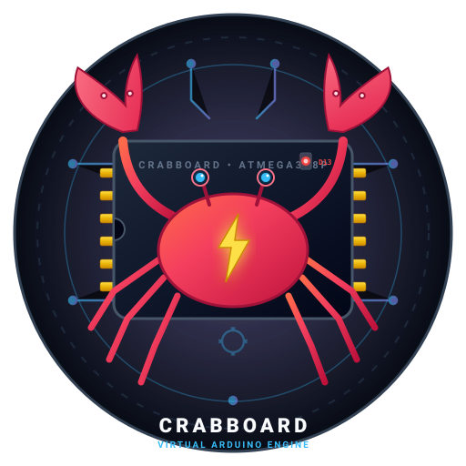

<p align="center">
  
</p>

<h1 align="center">CrabBoard 🦀⚡</h1>

<p align="center">
  <strong>An interactive, event-driven virtual Arduino microcontroller engine in Rust with C++ sketch support, circuit DSL, and physical heuristic simulation.</strong>
</p>

<p align="center">
  
  
  
  
</p>

---

## ⚡ Overview

**CrabBoard** is a virtual microcontroller and hardware simulation engine built in Rust. It compiles and executes real Arduino C++ sketches through a C Foreign Function Interface (FFI) bridge, models physical electronic behaviors (like diode burnout and brownout), and provides a declarative circuit DSL (`circuit.spec`).

```text
┌─────────────────────────────────┐
│     sketch.cpp (User C++)       │
│  #include "Arduino.h"           │
│  void setup() { ... }           │
│  void loop_sketch() { ... }     │
└────────────────┬────────────────┘
                 │ Calls digitalWrite, delay, etc.
┌────────────────▼────────────────┐
│      Arduino.h (C Header)       │
│ Exposes C ABI wrappers for Rust │
└────────────────┬────────────────┘
                 │ FFI Boundary (extern "C")
┌────────────────▼────────────────┐
│      CrabBoard Core (Rust)      │
│  Updates pins, state & events   │
└────────────────┬────────────────┘
                 │ Heuristics & Bus
┌────────────────▼────────────────┐
│  Physics & Interactive Console  │
│  - Diode current limiter check  │
│  - 200mA brownout threshold     │
│  - Live TUI (Spacebar button)   │
└─────────────────────────────────┘
```

---

## 🌟 Key Features

* **⚡ Native C++ Firmware Execution:** Run standard Arduino sketches (`sketch.cpp`) calling `pinMode`, `digitalWrite`, `digitalRead`, and `delay` through a high-performance C FFI bridge (`src/ffi.rs`).
* **📜 Declarative Circuit DSL:** Specify microcontrollers, components, pins, and resistors in clean `circuit.spec` files parsed with Pest PEG grammar (`src/circuit.pest`).
* **💥 Heuristic Physics Simulation:**
  * **The Magic Smoke Law (Burnout):** LEDs connected to 5V pins without current-limiting resistors will permanently burn out with an audible warning.
  * **The Thermal Budget Law (Brownout):** Simulates the ATmega328P's 200mA total current budget; drawing excessive current halts the MCU.
  * **The Floating Pin Law (Noise):** Reading a pin configured as a floating `INPUT` produces realistic electromagnetic noise instead of static logic.
* **🎮 Interactive Terminal Dashboard:** Multi-threaded TUI powered by `crossterm`. Toggle virtual buttons with `[SPACE]`, monitor pin states and real-time current draw, and quit with `[Q]`.

---

## 🛠️ Project Structure

```text
.
├── assets/
│   └── crabboard.svg       # Vector brand icon
├── include/
│   └── Arduino.h           # Mock Arduino standard header
├── src/
│   ├── circuit.pest        # PEG grammar for hardware declarations
│   ├── circuit.rs          # AST & circuit specification parser
│   ├── components.rs       # Physical component models (LED, Button)
│   ├── core.rs             # Virtual MCU, pin registers & event bus
│   ├── ffi.rs              # C-compatible FFI bridge
│   ├── main.rs             # Interactive TUI dashboard & runtime loop
│   └── sketch.rs           # Pure Rust Sketch trait
├── build.rs                # Compiles sketch.cpp with cc and links binary
├── circuit.spec            # Circuit hardware specification
├── sketch.cpp              # Native C++ Arduino firmware
└── Cargo.toml
```

---

## 🚀 Quickstart

### Prerequisites

* [Rust & Cargo](https://rustup.rs/) (edition 2021 or newer)
* A C++ compiler (`g++` or `clang++`)

### 1. Clone the repository
```bash
git clone https://github.com/JohnEsleyer/crabboard.git
cd crabboard
```

### 2. Run the simulation
```bash
cargo run
```

* Hit **`[SPACE]`** to press or release the interactive button on Pin 2.
* Watch the C++ sketch react by driving Pin 13, updating current draw and status live on the dashboard.
* Hit **`[Q]`** or **`[ESC]`** to safely exit raw terminal mode.

### 3. Run the automated tests
```bash
cargo test
```

---

## 💥 Testing Heuristic Failures

### Cause LED Diode Burnout
Edit `circuit.spec` to remove the current-limiting resistor:

```text
MCU ArduinoUno

// Dangerous: No resistor!
LED StatusLed -> pin(13)
BUTTON ActionBtn -> pin(2)
```

Run `cargo run` and press `[SPACE]`. CrabBoard will trigger a critical failure:
```text
💥 CRITICAL HEURISTIC FAILURE:
💥 POP! StatusLed on Pin 13 had no current-limiting resistor! Excess current destroyed diode.
```
The LED status changes permanently to `💥 [BURNED OUT]`.

### Fix the Circuit
Restore the resistor in `circuit.spec`:
```text
MCU ArduinoUno

LED StatusLed -> pin(13) [resistor: 220R]
BUTTON ActionBtn -> pin(2)
```
The LED will operate nominally, drawing ~20mA without burning out!

---

## 📄 License

MIT or Apache-2.0.
